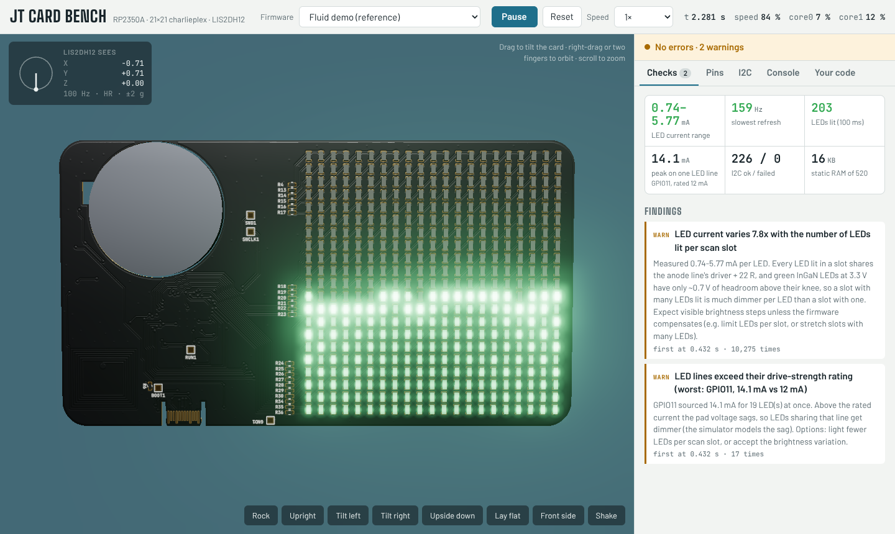
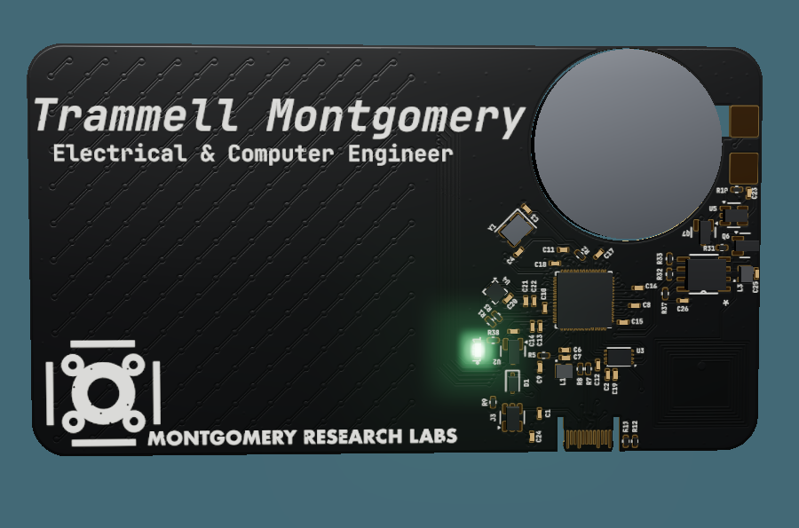

# S.I.M. (Simple Implementation Machine)

**A 3D hardware-in-the-loop simulator for an RP2350 business card that was never fabricated.**

S.I.M. runs the card's real Pico SDK C firmware, unmodified, against an
electrical model of the circuit built straight from its KiCad files, and shows
the result on a 3D card you can tilt. It answers the question a first prototype
would have answered: *does this firmware drive this hardware correctly?*



The board: an RP2350A, a 21×21 charlieplexed matrix of 441 green 0603 LEDs on
22 GPIOs, a LIS2DH12 accelerometer, an ST25DV04K NFC tag and a coin cell. The
reference firmware is a particle fluid that flows as you tilt the card.



## Try it

- **In a browser, nothing to install:** open [`docs/index.html`](docs/index.html),
  or this repository's GitHub Pages site if it is enabled (Settings → Pages →
  branch `main`, folder `/docs`). Drag the card to tilt it; right-drag to orbit.
- **With your own firmware:** follow the quick start below.

## Quick start

Requirements: Node.js 18+, Python 3, and clang + wasm-ld (LLVM 15 or newer).

```sh
npm install                       # Binaryen, three.js, esbuild

# macOS: Apple's clang has no WebAssembly target, so use Homebrew's LLVM
brew install llvm lld
export PATH="$(brew --prefix llvm)/bin:$(brew --prefix lld)/bin:$PATH"
# Ubuntu / Debian:  sudo apt install clang lld

npm run build                     # compile the reference firmware to .wasm
npm test                          # run it headless and print a report
node tools/sim.mjs firmware/fluid-demo   # compile and open the 3D view
```

| Task | Command |
| --- | --- |
| Compile a firmware folder and open it in 3D | `node tools/sim.mjs path/to/firmware` |
| Open a `.wasm` you already built | `node tools/sim.mjs fw.wasm` |
| Compile only | `node tools/build-firmware.mjs path/to/firmware -o fw.wasm` |
| Text report, for scripts and CI | `node tools/run-headless.mjs fw.wasm` (exit 0 = no errors, 1 = errors, 2 = firmware stopped) |
| Rebuild the page in `docs/` | `npm run pages` |

The same firmware also builds for the real chip with the Pico SDK; see
[`firmware/fluid-demo/CMakeLists.txt`](firmware/fluid-demo/CMakeLists.txt).

## How it works

```
 .kicad_pcb ──┬─ kicad_pcb_extract.py ─▶ board.json ───────┐
              │                         led_map.h ─▶ firmware
              └─ kicad_artwork.py ────▶ artwork.json ─┐    │
                                                      │    ▼
 firmware C ──── build-firmware.mjs ──▶ firmware.wasm ─▶ engine.js ── board.js ── devices.js
                 clang → cycle counter → asyncify     │   (2 cores,    (pins,      (LIS2DH12,
                                                      │    virtual      LED solve,   ST25DV)
                                                      ▼    time, IRQs)  I2C checks)
                                          3D page (three.js)   or   run-headless.mjs
```

**Reading the design files.** A dependency-free Python S-expression parser reads
the `.kicad_pcb`. It finds the 22 GPIO lines through the series resistors
between `Net-(U1-GPIOn)` and `/LED_ARRAY/Dk` nets, finds every LED with both pads
on LED nets, uses the pads' A/K pin functions to tell anode from cathode, and
clusters positions into the 21×21 grid. A second script extracts the visual
layers: Edge.Cuts chained into the outline and cutouts, copper, mask openings, and
silkscreen. Silkscreen text comes from the polygons KiCad caches for outline fonts,
so it renders exactly.

**Running the firmware.** The firmware is compiled with clang to WebAssembly
against a *simulated Pico SDK*: 22 headers with the real SDK's names and
signatures, implemented on about 30 JavaScript imports. Calling an unsupported
SDK function fails at link time with its name. A Binaryen pass adds a Cortex-M33
instruction-cost counter, so compute time is deterministic. Binaryen's asyncify
pass lets the engine suspend and resume each core at any SDK call, which gives
two cores with their own stacks and virtual clocks, kept within 5 µs of each
other, plus timers, alarms and GPIO interrupts on core 0.

**The electrical model.** Every pin change re-solves the charlieplex matrix.
Each driven line is a source behind the pad resistance plus the 22 Ω resistor,
and each conducting LED is a 2.55 V knee plus 32 Ω. Kirchhoff's current law
gives a small linear system, solved directly. Current is added over time per
LED, which becomes brightness and refresh rate. The model also flags pins over
their drive rating, leakage glow through pull resistors, shorts, and outputs
fighting other chips.

**Peripherals.** I2C transactions succeed only if the bus would really work:
the pins are routed, and the pull-ups (powered from GPIO29 on this board) are
on. A register-level LIS2DH12 model samples gravity from the 3D card's
orientation, rotated into the sensor's axes using its footprint pose in the PCB.

A longer write-up of each part is in [docs/HOW-IT-WORKS.md](docs/HOW-IT-WORKS.md).

## What it found on rev E1

| Finding | Consequence |
| --- | --- |
| LED current varies 7.8× (0.74–5.77 mA) with the number of LEDs lit in a scan slot | A full pool looks patchy. Green InGaN at 3.3 V leaves ~0.7 V for the driver and 22 Ω resistor |
| An anode line peaks at 14.1 mA against a 12 mA drive rating | Voltage sag, adding to the dimming |
| GPIO26/27/28 have no-connect flags but are wired to GND | Driving one high is a short |
| The I2C pull-ups are powered from GPIO29, not 3V3 | Nothing answers on I2C until firmware drives GPIO29 high |
| The LIS2DH12 is rotated −45° and on the opposite side from the LEDs | Firmware must rotate and mirror its axes |

## Build a simulator for your own board

Most of the code knows nothing about this card. The parts to adapt:

| To change | Where |
| --- | --- |
| How the board looks in 3D | Nothing: run `tools/kicad_artwork.py` on any KiCad 7–9 board |
| How LEDs and GPIOs are found | Net-name patterns and the accelerometer reference in `tools/kicad_pcb_extract.py` |
| LED drive topology | `solve()` in `sim/core/board.js` (any charlieplex works as is) |
| Component values | `ELEC` at the top of `sim/core/board.js` |
| Board-specific hazards | `checkHazards()` and `I2CBus.checkBus()` in `sim/core/board.js` |
| I2C chips | A class with `start` / `write` / `read` / `stop` in `sim/core/devices.js`, registered in `engine.js` |
| More SDK functions | Header in `sim/hal/include`, C in `sim/hal/src/hal.c`, an import in `sim_imports.h` and `makeImports()` |
| Another MCU or SDK | New headers in `sim/hal/`; the compiler pipeline, scheduler and board model are unchanged |

Keep a deliberately broken firmware next to the real one, like
[`firmware/examples/common-mistakes`](firmware/examples/common-mistakes/main.c).
If the simulator does not catch the bugs you planted, it will not catch the ones
you did not plan.

After a PCB change:

```sh
python3 tools/kicad_pcb_extract.py board/JT-Business-Card.kicad_pcb \
    -o board/board.json --header firmware/fluid-demo/led_map.h
python3 tools/kicad_artwork.py board/JT-Business-Card.kicad_pcb -o board/artwork.json
npm run build && npm run pages
```

## Limitations

- Not an ARM emulator: firmware is recompiled, so direct register access
  (`sio_hw->…`), PIO, DMA, PWM, ADC, USB and flash writes are not simulated.
- Interrupts and core switches happen at SDK calls, so races shorter than ~5 µs
  are not reproduced. A busy-wait on the other core must call an SDK function
  such as `tight_loop_contents()`.
- LED I-V fit, pad resistances and instruction costs are estimates; absolute
  currents and CPU load should be confirmed on hardware.
- The LIS2DH12 axis directions follow the datasheet's top-view figure; confirm
  them by holding the first board upright.
- Solder-mask colour and finish are not stored in KiCad files, so they are a
  viewer setting.

## Project layout

| Path | Contents |
| --- | --- |
| `board/` | The card's KiCad PCB and schematic, plus the extracted `board.json` and `artwork.json` |
| `firmware/fluid-demo/` | Reference firmware: charlieplex scan driver, LIS2DH12 driver, particle fluid |
| `firmware/examples/common-mistakes/` | Firmware that is wrong on purpose, to show each check firing |
| `sim/hal/` | The simulated Pico SDK |
| `sim/core/` | Engine (`engine.js`), electrical model (`board.js`), I2C devices (`devices.js`) |
| `sim/web/` | The 3D page: scene, artwork painter, UI |
| `tools/` | Extractors, firmware build, cycle counter, page build, headless runner, launcher |
| `docs/` | The built simulator page (for GitHub Pages) and screenshots |

## License

[MIT](LICENSE).
