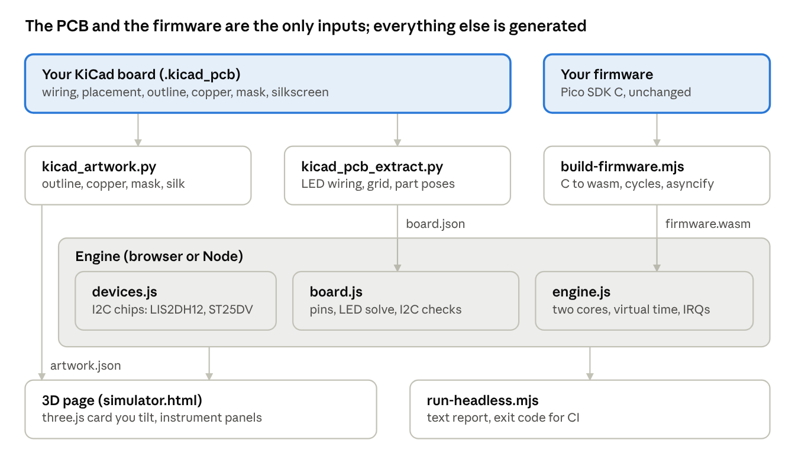

# JT Card Bench: How the Simulator Works

Trammell Montgomery · October 2026

## Overview

JT Card Bench runs the business card's unmodified Pico SDK firmware against a model of the real circuit, built from the KiCad files, and shows the result on a 3D card you can tilt. It exists because the card (rev E1: RP2350A, a 21×21 charlieplexed matrix of 441 green LEDs, a LIS2DH12 accelerometer and an ST25DV04K NFC tag) was never fabricated. The simulator answers the question a first board would have answered: does this firmware drive this hardware correctly?

It verifies three things at once:

- **Logic:** the same C source that builds a `.uf2` for the RP2350 compiles for the simulator and runs on two simulated cores, with interrupts, timers and the inter-core FIFO.
- **Electrical behaviour:** which LEDs actually conduct for every pin state, how much current each gets, and whether any pin is overloaded, shorted or leaking.
- **Protocol behaviour:** every I2C transaction reaches a register-level model of the accelerometer, which reports gravity from the 3D card's orientation.

It is not a cycle-exact emulator of the RP2350. It does not run the compiled ARM binary, simulate PIO or DMA, or model analog effects beyond a simple LED and pin-driver model. Those limits are listed under Assumptions and limitations.

## Architecture at a glance

Two inputs feed one engine: the KiCad files become JSON descriptions of the board, and the C firmware becomes a WebAssembly module. The engine runs the firmware against the board model, and either the 3D page or a command-line runner shows the result.



The three tools turn your two files into the engine's inputs. `led_map.h` also goes back into the firmware, so the C code and the simulator share one LED map.

1. **Design files → JSON.** Two Python scripts parse the `.kicad_pcb`. `kicad_pcb_extract.py` writes `board.json` (LED wiring, LED grid, part placement, accelerometer pose) and the firmware header `led_map.h`. `kicad_artwork.py` writes `artwork.json` (outline, copper, mask openings, silkscreen).
2. **Firmware → WebAssembly.** `build-firmware.mjs` compiles the firmware's C files with clang against a simulated Pico SDK, adds a cycle counter, and runs Binaryen's asyncify pass.
3. **Engine.** `engine.js` loads the module and schedules both cores. `board.js` models the pins and the LED matrix. `devices.js` models the I2C chips.
4. **Front ends.** `build-web.mjs` bundles the engine, both JSON files and the firmware into one HTML page with a three.js scene. `run-headless.mjs` runs the same engine in Node and prints a report for scripts and CI.

| Path | Role | Lines |
| --- | --- | --- |
| `tools/kicad_pcb_extract.py` | S-expression parser, LED wiring and placement → `board.json`, `led_map.h` | 296 |
| `tools/kicad_artwork.py` | Visual layers → `artwork.json` | 327 |
| `tools/build-firmware.mjs` | clang → wasm-ld → cycle counter → asyncify | 151 |
| `tools/instrument-cycles.mjs` | Cortex-M33 instruction-cost counter (Binaryen) | 133 |
| `sim/hal/` | Simulated Pico SDK: 22 headers plus `hal.c`, `libc.c`, `libm.c` | 1,673 |
| `sim/core/engine.js` | Loader, two-core scheduler, interrupts, virtual time | 480 |
| `sim/core/board.js` | Pads, charlieplex nodal solver, I2C bus checks | 454 |
| `sim/core/devices.js` | LIS2DH12 and ST25DV04K register models | 235 |
| `sim/web/` | 3D page: scene, artwork painter, UI | 1,177 |
| `tools/run-headless.mjs`, `tools/sim.mjs` | Command-line runner; compile-and-open launcher | 176 |
| `firmware/fluid-demo/` | Reference firmware: scan driver, accelerometer driver, fluid | 680 |

## Reading the design files

Everything the simulator knows about the card comes from the `.kicad_pcb`, read by a dependency-free Python parser; nothing is typed in by hand. The schematic was used once, to cross-check the GPIO nets.

### The parser

KiCad 9 files are S-expressions: nested parenthesised lists such as `(footprint "LED_0603" (at 105.52 96.38 90) (pad "1" ...))`. A single regular expression splits the 5 MB file into tokens (open, close, quoted string, atom), and a stack turns them into nested Python lists. Helpers such as `children(node, "pad")` and `prop(fp, "Reference")` then walk the tree.

### Coordinates

KiCad measures in millimetres with y pointing down, and angles run counter-clockwise on screen. A footprint's pads and graphics are stored relative to the footprint, so each is rotated by the footprint angle and offset by its position. Footprints on the back copper are stored already mirrored, so only the rotation applies.

### LED wiring (`board.json`)

1. **Find the GPIO lines.** Each of the 22 series resistors has one pad on a net named `Net-(U1-GPIOn)` and the other on `/LED_ARRAY/Dk`. That pairing gives the map from GPIO to LED line: GPIO0 drives D22 through R4, and GPIO21 drives D1 through R36.
2. **Find the matrix LEDs.** A matrix LED is any two-pad part whose pads are both on `/LED_ARRAY` nets. Pin functions in the file (`A`/`K` or `ANODE`/`CATHODE`) say which pad is which, with pad numbers as a fallback. This found exactly 441 LEDs and excluded LED1, the power indicator.
3. **Place them on a grid.** LED positions are clustered by y into 21 rows and by x into 21 columns (2.25 mm pitch).
4. **Check the result.** The script flags LEDs not driven by a GPIO, LEDs with both pads on the same line, LED pairs that share a pin pair, and two LEDs in one grid cell. Rev E1 passed all four checks.
5. **Write the firmware header.** `led_map.h` gives the anode and cathode GPIO for every display position, mirrored left-right because the LEDs sit on the back copper. The firmware and the simulator therefore share one source of truth.

The same pass records every other part's reference, value, side, position and rotation. That is how the simulator learns that U4, the LIS2DH12, is on the front copper at −45°.

### Visual layers (`artwork.json`)

| Layer | Taken from | Notes |
| --- | --- | --- |
| Outline | Edge.Cuts lines and arcs, board-level and inside footprints | Pieces are chained end to end into closed loops, within 0.02 mm. The largest loop is the outline and the rest are cutouts. This recovers the USB-C paddle slots (inside J1) and the round coin-cell cutout (inside BT1). |
| Copper | Tracks, zone fills, vias, pads, copper circles | 2,207 track segments and about 49,000 zone-fill points. Arcs are converted to polylines. |
| Mask openings | Pads whose layer list includes `F.Mask`, `B.Mask` or `*.Mask` | Includes each pad's solder-mask margin. The file contains no shapes drawn on the mask layers themselves. |
| Silkscreen text | `render_cache` polygons stored with each text item | KiCad saves outline-font text as ready-made polygons, so the name, title and company name render exactly, with no font needed. |
| Silkscreen graphics | Footprint and board lines, arcs, circles and filled polygons | Includes the logo (five filled polygons) and every footprint outline. |
| Reference designators | Visible `Reference` properties on silkscreen layers | These use KiCad's built-in stroke font, which has no cached outlines, so the page draws them in JetBrains Mono at the same height and position. |
| Holes | Via drills and thru-hole pad drills | Marked as open or tented (covered by mask). |

The solder-mask colour and surface finish are not stored in KiCad files: they are chosen when ordering. They are therefore viewer settings in the page.

## Running real firmware

The firmware is ordinary blocking C, so the simulator recompiles it for the browser rather than emulating ARM instructions. The source is the same one that builds a `.uf2` for the chip. The fluid demo was built both ways, with Pico SDK 2.1.1 for RP2350 producing a 75 KB `fluid_demo.uf2`.

### A simulated Pico SDK

`sim/hal/include` holds 22 headers with the same names and function signatures as the real SDK: `pico/stdlib.h`, `hardware/gpio.h`, `hardware/i2c.h`, `pico/multicore.h`, `pico/time.h` and others. `#include "pico/stdlib.h"` therefore resolves to the simulator's version without any change to the firmware.

Behind those headers, `hal.c` implements each SDK call in terms of about 30 primitive imports declared in `sim_imports.h`, which JavaScript provides. For example, `gpio_set_dir_out_masked(mask)` becomes `sim.gpio_set_oe(mask, mask)`, and `i2c_read_blocking` becomes `sim.i2c_xfer(...)`. A small freestanding C library (`libc.c`, `libm.c`) supplies `printf`, `malloc` and the maths functions, so no WASI or Emscripten runtime is needed.

### The build, step by step

1. **Compile.** clang targets `wasm32-unknown-unknown` at `-O2`, with `-ffreestanding` and the simulated SDK first on the include path. `PICO_SIMULATOR=1` is defined in case firmware wants simulator-only code.
2. **Link.** wasm-ld runs without `--allow-undefined`, so a call to an SDK function the simulator lacks fails at build time with its name rather than doing nothing. Core 0's stack (64 KB) sits first in memory, followed by data and then the heap.
3. **Count cycles.** `instrument-cycles.mjs` walks every function with Binaryen. At the top of each function body and of each loop iteration, it adds the estimated Cortex-M33 cycle cost of the straight-line code in that region to a counter, `sim_cycles`.
4. **Asyncify.** `wasm-opt --asyncify` rewrites the module so its call stack can be saved and restored. `sim.yield` is declared as the only import allowed to suspend.

| Operation | Cycles charged | Why |
| --- | --- | --- |
| ALU, compare, branch, select | 1 | Single-cycle on the M33 |
| Load / store | 2 / 1 | |
| Call / indirect call | 3 / 4 | |
| 32-bit divide | 6 | Hardware divider |
| 64-bit add, logic | 3 | 32-bit core |
| 64-bit multiply or divide | 20 | |
| float divide, square root | 14 | FPv5 single-precision FPU |
| Any double-precision operation | 40 | No double-precision hardware: emulated in software |

Both arms of an `if` are charged, a slight over-estimate in the safe direction. Cycles become time at the current system clock (150 MHz by default; `set_sys_clock_khz` changes it), so compute time no longer depends on how fast the viewer's computer is.

### Two cores and virtual time

Each core has its own C stack, its own 64 KB asyncify buffer and its own clock in microseconds since boot. Every SDK call ends in `sim.yield(cost)`, which adds the call's cost and the cycles executed since the last call to the running core's clock. The engine then decides whether to switch.

- **Switching.** The engine unwinds the running core's stack into its buffer, then rewinds the other core from where it last stopped. A core is suspended when it gets more than 5 µs ahead of the other, when it reaches the end of the current time slice, or when an interrupt is due on core 0. The scheduler always resumes the core that is further behind, so shared variables and the inter-core FIFO behave much as they do on the chip.
- **Waiting.** `sleep_us`, `busy_wait_us` and I2C transfers advance the clock by their full duration. A register access costs 10 ns and a pad configuration 20 ns, so bit-banged sequences take realistic time.
- **Interrupts.** Repeating timers, alarms and GPIO interrupts run on core 0, on a separate stack, once core 0's clock passes their due time. `save_and_disable_interrupts()` holds them off, as on the chip.
- **Busy-waits.** A loop that waits for the other core must call an SDK function, such as the recommended `tight_loop_contents()`. Otherwise the simulator has no point at which to switch cores.
- **Faults.** `panic`, failed `assert` and out-of-range GPIO numbers stop the simulation and report the message.

In the browser, each animation frame asks the engine to advance by the frame's real duration multiplied by the chosen speed, within a 22 ms budget, so a busy page never freezes. The fluid demo runs at about 80% of real time in software-rendered Chrome, and slow motion down to 1/1000× is available.

## The electrical model

Every time the firmware changes a pin, `board.js` works out which of the 441 LEDs conduct and how much current each one gets. It then adds that current over time, which is what the eye sees as brightness.

### Pin state

The model holds the RP2350's pad state for GPIO0–29: function select, output enable, output level, pull-up, pull-down, input enable and drive strength. It starts from the chip's reset state: no function selected, input, pull-down on, input buffer on, 4 mA drive. Every SDK GPIO call updates this state. Any change that touches an LED line triggers a new solve.

### Which LEDs conduct

Each LED line is high, low or high-impedance at any instant. An LED conducts directly when its anode line is driven high and its cathode line driven low. Its current depends on every other LED lit at the same moment, because LEDs that share a line also share that line's pin driver and 22 Ω resistor.

The solver treats it as a small circuit:

- Each driven line is a voltage source (3.3 V or 0 V) behind the pad's output resistance plus the 22 Ω series resistor. Pad resistance depends on the drive-strength setting: 160, 80, 40 and 27 Ω for 2, 4, 8 and 12 mA (estimates).
- Each conducting LED is a 2.55 V knee in series with 32 Ω. This straight-line fit gives about 3.2 V at 20 mA for the green 150060GS75000.
- Kirchhoff's current law at each line gives a linear system, solved directly by Gaussian elimination. Any LED that comes out reverse-biased is switched off and the system is solved again, for at most six passes.

```
I_LED = max(0, (V_anode − V_cathode − V_th) / R_d),   V_th = 2.55 V,  R_d = 32 Ω
```

### Leakage glow

A high-impedance line with its pull resistor still enabled lets a small current through neighbouring LEDs. Examples are a pull-down next to a driven-high anode, a pull-up next to a driven-low cathode, or a pull-up opposite a pull-down. Through the RP2350's roughly 50 kΩ pulls that is about 0.019 mA, enough for a faint visible glow from green InGaN LEDs. Because the pull-down is on at reset, firmware that forgets `gpio_disable_pulls()` on the LED lines shows exactly this.

### Brightness and refresh rate

The model adds each LED's current over time as charge in mA·µs, so the average current between any two moments is a subtraction. The 3D view uses a 30 ms window at normal speed, about what the eye integrates, and shorter windows in slow motion so individual scan slots become visible. Each separate on-pulse is counted too, which gives every LED's refresh rate.

### Checks on every solve

| Check | Severity | Trigger |
| --- | --- | --- |
| Pin over its drive rating | Warning | Pad current above 1.05× its drive-strength setting |
| Total GPIO current | Warning | Sum of sourced current above 50 mA (a conservative guideline) |
| Uneven LED brightness | Warning | Brightest directly-driven LED gets more than 2× the current of the dimmest |
| Leakage glow | Warning | Any LED lit only through a pull resistor |
| RP2350 erratum E9 conditions | Info | Input buffer and pull-down both on for a high-impedance LED line |
| Short to ground | Error | GPIO26, 27 or 28 driven high; the schematic wires them to GND |
| Output fighting the accelerometer | Error | GPIO24 or 25 set as an output while the LIS2DH12 drives that net |

## Peripheral models

An I2C transaction succeeds only if the bus would physically work on the card. It then reaches a byte-level model of the chip at that address, which responds the way the datasheet says it should.

### The I2C bus

All three addresses sit on I2C1, on GPIO22 (SDA) and GPIO23 (SCL): 0x18 for the LIS2DH12, and 0x53 and 0x57 for the ST25DV04K's user memory and system area. Before each transaction the bus is checked in this order, and the first failure ends it with the SDK's error code:

1. `i2c_init()` has been called for that controller, at no more than 400 kHz (the LIS2DH12's limit).
2. The controller is I2C1. I2C0 has no devices on this board.
3. GPIO22 and GPIO23 are both set to `GPIO_FUNC_I2C`.
4. The pull-ups are powered. R1 and R3 (5.1 kΩ) hang off GPIO29, net ENABLE_ACCEL, not 3V3. GPIO29 driven high works. Driven low, it holds the bus low (on hardware the call would hang). Left as an input, the bus fails, except at 100 kHz or slower with the RP2350's internal pull-ups on, which gives a low-margin warning.
5. A device answers at that address; otherwise it is a NACK.

Each transaction charges its bus time to the calling core: (bytes + 1) × 9 bit times plus start and stop, at the configured baud rate. The page keeps the last 64 transactions with their bytes and result for the I2C tab.

### LIS2DH12 accelerometer

The model implements the registers a driver touches, with their datasheet behaviour:

- **Identity:** WHO_AM_I (0x0F) reads 0x33.
- **Rate and mode:** CTRL_REG1 sets the output data rate (power-down, 1 Hz up to 5.376 kHz) and low-power mode. CTRL_REG4 sets high-resolution mode, full scale (±2, 4, 8 or 16 g) and block data update. Resolution follows mode: 8-bit, 10-bit or 12-bit, with the matching mg-per-digit sensitivity.
- **Data:** at each sample tick the model takes the current orientation, adds 1.5 mg RMS of Gaussian noise, scales and clips it, and stores left-justified 16-bit values in OUT_X_L to OUT_Z_H. Reads between ticks return the latched sample.
- **Status and interrupts:** STATUS_REG reports new data and overrun. With I1_ZYXDA set in CTRL_REG3, the INT1 pin goes active on new data, respecting the polarity bit in CTRL_REG6. That can fire a GPIO interrupt on GPIO24.
- **Addressing quirks:** the sub-address MSB (0x80) enables auto-increment. A multi-byte read without it returns the same register repeatedly, as on the real chip, and triggers a warning.
- **Misuse checks:** reading data in power-down, setting low-power and high-resolution together (not allowed by the datasheet), and writing reserved registers (0x00–0x06 hold factory calibration) are all reported.

The model needs gravity in the sensor's own axes. The engine rotates the card's gravity vector into them using U4's footprint rotation (−45°) and side (front) from the PCB.

### ST25DV04K NFC tag

At 0x53 the model holds 512 bytes of user memory with 16-bit addressing, preloaded as a blank Type 5 tag: a capability container and an empty NDEF record. At 0x57 the system area answers with the chip's IC reference and accepts, but ignores, writes, standing in for the password-protected registers. That is enough for bus scans, NDEF reads and writes, and checking that the tag answers. The RF side is not modelled.

## The 3D view

The page is a single 1.1 MB HTML file that contains the engine, both board descriptions and the firmware. Only three.js 0.160 loads from a CDN. Everything on the card is drawn from the PCB data: nothing is placed by hand.

### Building the board

The Edge.Cuts outline and its cutouts become a three.js shape, extruded to the 0.6 mm thickness from the PCB's stackup. Each face gets a material painted from `artwork.json` with the browser's 2D canvas, at about 25 pixels per millimetre (2,400 px across at most). That is fine enough to read the 0.6 mm reference labels. Two canvases are painted per face, with identical geometry:

- **Colour:** what you see.
- **Material:** red for height (silkscreen and copper stand slightly proud), green for roughness (matte ink, satin mask, shiny pads) and blue for metalness (only exposed pads are metal). three.js reads these as bump, roughness and metalness maps.

The painting order follows how a board is made:

1. Solder mask over bare laminate.
2. Copper under the mask as a lighter tint (traces, pours, vias, the NFC coil).
3. Silkscreen.
4. Mask openings in the chosen finish, drawn after the silk so silk never prints on a pad, as fabs clip it.
5. Drill holes, with tented vias shown as small dimples.

Seven mask colours and three finishes (ENIG gold, HASL silver, bare copper) are offered. The choice is remembered per browser.

### Parts and light

The 441 LEDs are one instanced mesh placed at their PCB coordinates, each paired with an additive glow sprite. Each frame, every LED's average current over the exposure window sets its glow, scaled by a square root to approximate how brightness is perceived. A bloom pass with a threshold of 1.0 makes only lit LEDs glow, not the white silkscreen. Other parts are simple bodies sized by footprint type, such as the 7×7 mm QFN-60 for the RP2350. The coin cell sits inside its board cutout, and LED1, the power indicator, is always on.

### Tilt to gravity

Dragging rotates the card. Each frame the page takes "up" in the room (1 g, what an accelerometer at rest reports) and rotates it into the card's own axes using the inverse of the card's rotation. Shake adds a decaying wobble for 450 ms. The engine then rotates that vector into the LIS2DH12's axes from its footprint pose, and the sensor model samples it at its output rate. The firmware reads it over I2C and rotates it back into display axes (`gx = (ax + ay) / √2`, `gy = (ay − ax) / √2`). If any step of that chain is wrong, the fluid flows the wrong way, which makes the chain easy to check by eye.

### Instrument panels

| Panel | Shows |
| --- | --- |
| Status banner | Error and warning counts, or why the firmware stopped |
| Checks | LED current range, slowest refresh rate, LEDs lit, peak pin current, I2C successes and failures, static RAM, and every finding with when it first happened and how often |
| Pins | Function, level, pulls, drive rating and live and peak current for GPIO0–29, labelled with their nets |
| I2C | Key LIS2DH12 registers, pull-up state and a trace of the last 24 transactions |
| Console | The firmware's `printf` output with timestamps |
| Your code | Build commands, loading a `.wasm`, exposure, mask colour and finish |
| Overlay | What the accelerometer reports, a gravity compass, and pose buttons from Upright to Shake |

## Verification and findings on rev E1

The reference firmware runs with no errors and two warnings, and both warnings point at the hardware rather than the code. The simulator itself was checked four ways before its findings were trusted.

### How the simulator was checked

1. **A real-hardware build.** The same fluid-demo sources compile with the official Pico SDK 2.1.1 for RP2350, so the simulated SDK did not hide any real compile errors.
2. **Firmware that is wrong on purpose.** `firmware/examples/common-mistakes` makes four classic errors. Each produced the expected finding: unpowered I2C pull-ups (error), GPIO27 driven high into ground at about 41 mA (error), a burst read without auto-increment (warning), and 21 LEDs glowing at 0.019 mA through the reset pull-downs (warning).
3. **Physical behaviour.** Runs held the card at 0°, 90°, −45° and 180°. Each time the fluid settled against the side gravity pointed at, with a level surface. This confirmed the whole chain from tilt through the accelerometer model, the I2C driver and the axis mapping to the LEDs.
4. **A command-line runner.** `run-headless.mjs` prints an ASCII map of LED brightness for each pose, an electrical summary and every finding. It exits with 0 for no errors, 1 for errors and 2 if the firmware stopped, so it can gate a CI pipeline. On a Mac it simulates 3 s of firmware time in 0.4 s.

### Reference firmware results

| Measure | Result |
| --- | --- |
| Refresh rate (settled LEDs) | About 450 Hz, anode-at-a-time scan with 4-bit binary code modulation |
| Current per lit LED | 0.74 to 5.77 mA, depending on LEDs sharing the slot |
| Most LEDs lit at once | 19 |
| Busiest LED line | 14.1 mA peak on one anode (rated 12 mA) |
| Core 0 load (fluid at 60 Hz, accelerometer) | About 7% |
| Core 1 load (display scan) | About 12% |
| I2C | 320 transactions in 3 s, none failed |
| Static RAM | 16 KB of 520 KB |

### What it found about the board

| Finding | Kind | Consequence | Action |
| --- | --- | --- | --- |
| LED brightness varies 7.8× with the number of LEDs lit in a slot | Hardware | A full pool looks patchy: crowded rows dim, edges bright. Green InGaN at 3.3 V leaves only about 0.7 V for the pad driver and the 22 Ω resistor | Firmware: cap LEDs per slot or stretch crowded slots. Hardware: lower-Vf LEDs or smaller series resistors |
| An anode line peaks at 14.1 mA against its 12 mA drive rating | Hardware | Voltage sag on that line rather than damage; adds to the dimming above | Light fewer LEDs per slot |
| GPIO26, 27 and 28 carry no-connect flags but are wired to GND | Hardware | Driving any of them high is a short | Keep them as inputs, or remove the GND connection in the next revision |
| The I2C pull-ups are powered from GPIO29 (ENABLE_ACCEL), not 3V3 | Hardware, by design | Neither the accelerometer nor the NFC chip answers until firmware drives GPIO29 high | Drive GPIO29 high before any I2C; documented in `board.h` |
| The LIS2DH12 is rotated −45° and sits on the opposite side from the LEDs | Hardware | Without correction the fluid flows diagonally | Rotate the axes 45° and mirror them in firmware |
| LED lines start with pull-downs enabled at reset | Firmware requirement | Faint glow on LEDs that should be off | Call `gpio_disable_pulls()` on GPIO0–21 |

## Assumptions and limitations

The simulator is strongest on logic, wiring and protocol mistakes. Its absolute electrical numbers rest on estimated component values and should be confirmed on a first board.

### Estimated values

| Value | Used | Basis | Effect if wrong |
| --- | --- | --- | --- |
| LED knee voltage and slope | 2.55 V, 32 Ω | Straight-line fit to about 3.2 V at 20 mA; the RS listing gives only a single forward voltage of 3.5 V | Absolute LED currents shift. The brightness spread between crowded and sparse slots remains |
| Pad output resistance | 160 / 80 / 40 / 27 Ω for 2 / 4 / 8 / 12 mA | Engineering estimate of droop at rated current | How much a heavily loaded line sags |
| Internal pull resistors | About 50 kΩ | Typical RP2350 value | Strength of leakage glow |
| Total GPIO current guideline | 50 mA | Conservative threshold, not a datasheet limit | When the total-current warning fires |
| LIS2DH12 axis directions | X right, Y up in the datasheet's top view | Matches the footprint's pin 1 | A wrong guess mirrors or rotates the fluid; check by holding the first board upright |
| Instruction costs | Table under Running real firmware | Approximate Cortex-M33 timings | CPU load percentages; ignores flash wait states, cache misses and bus contention |

### Not simulated

- **Direct register access and other peripherals.** Code that writes `sio_hw->...` directly, or uses PIO, DMA, PWM slices, the ADC, USB or flash writes, does not build. The link step names the missing function rather than letting it fail silently.
- **Finer timing.** Interrupts and core switches happen only at SDK calls, so cross-core races shorter than about 5 µs and interrupt latency below one call are not reproduced. Memory is sequentially consistent.
- **Analog detail.** Pin capacitance and rise times, LED reverse leakage, temperature, and the battery and charger circuit are not modelled.
- **Off-board behaviour.** The NFC radio field and the external QSPI flash chip are not modelled.
- **Appearance details.** Reference designators use a stand-in font for KiCad's stroke font. Mask colour and finish are chosen in the viewer because the KiCad file does not store them.

## Building a simulator for your own board

Most of the project is reusable as it stands: the S-expression parser, the artwork extractor, the build pipeline, the two-core engine and the 3D painter know nothing about this card. What is specific to it sits in a few clearly separated places.

| To change | File | What to edit |
| --- | --- | --- |
| The board's look | `tools/kicad_artwork.py` | Nothing. It works on any KiCad 7–9 board: run it on your `.kicad_pcb` |
| How LEDs and GPIOs are found | `tools/kicad_pcb_extract.py` | The net-name patterns (`/LED_ARRAY/D*` and `Net-(U1-GPIOn)`) and the accelerometer reference (`U4`) |
| The LED drive topology | `sim/core/board.js`, `solve()` | Kept as is for any charlieplex. For a row/column matrix or a driver IC, replace which lines count as anode and cathode |
| Component values | `ELEC` at the top of `board.js` | Supply voltage, series resistor, LED knee and slope, pad resistances |
| Board-specific hazards | `checkHazards()` and `I2CBus.checkBus()` in `board.js` | Pins tied to rails, nets driven by other chips, how pull-ups are powered, which pins carry I2C |
| I2C chips | `sim/core/devices.js`, plus the address map in `engine.js` | Write a class with `start`, `write`, `read` and `stop`, register it at its address |
| SDK calls your firmware needs | `sim/hal/include`, `hal.c`, `sim_imports.h` and `makeImports()` in `engine.js` | Declare the function, implement it in C on a new import, implement the import in JavaScript |
| A different microcontroller or SDK | `sim/hal/` | Write headers that match that SDK (STM32 HAL, Arduino and so on). The compiler pipeline, asyncify, scheduler and board model are unchanged |
| Part bodies in 3D | `sizeOf()` in `sim/web/scene.js` | Body dimensions per footprint name |
| Built-in firmware | `FIRMWARE` in `tools/build-web.mjs` | Which `.wasm` files ship in the page |

A practical order is to get the artwork rendering first, since it only needs the `.kicad_pcb`. Then build a blink firmware against the simulated SDK, add the electrical model for your outputs, and add peripheral models one chip at a time. Keep a deliberately broken firmware next to the real one, like `common-mistakes`. If the simulator does not catch the bugs you planted, it will not catch the ones you did not plan.
